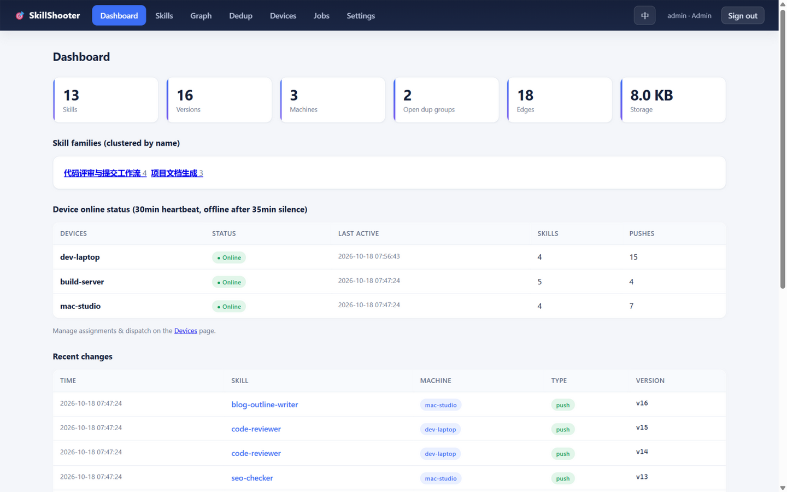
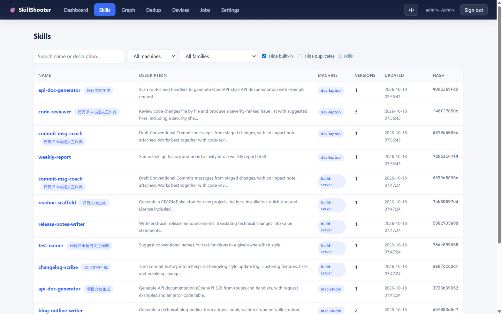
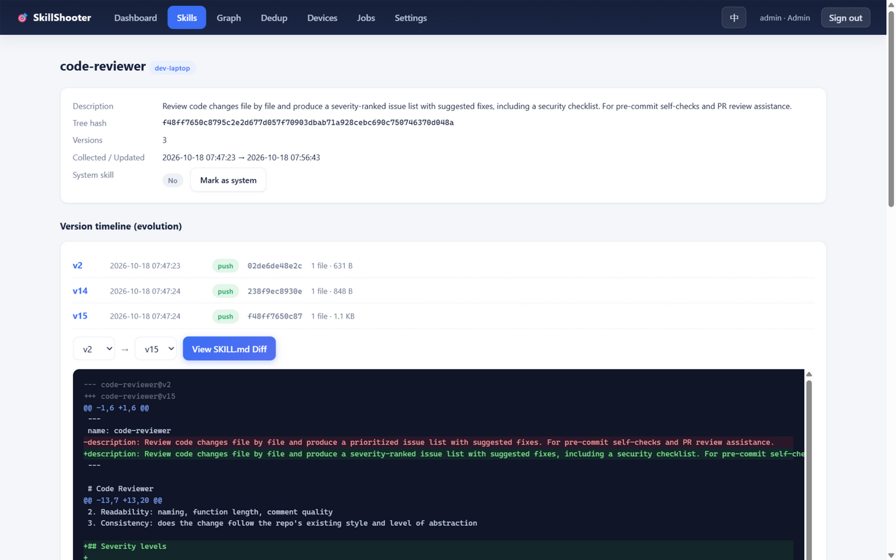
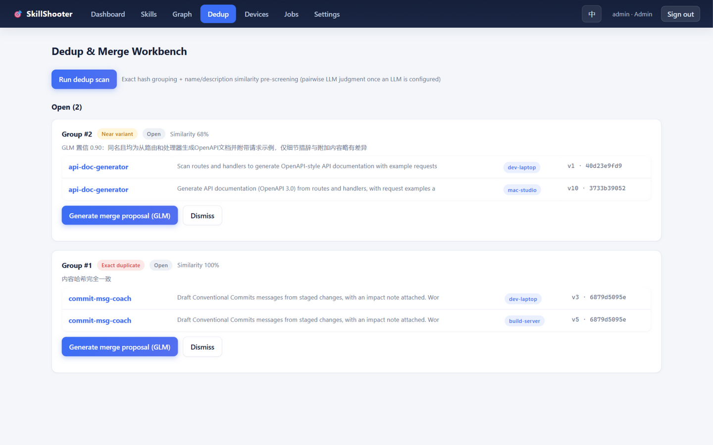
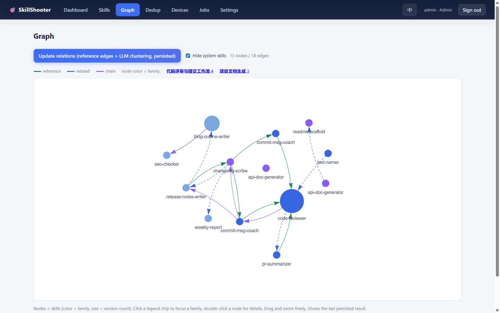
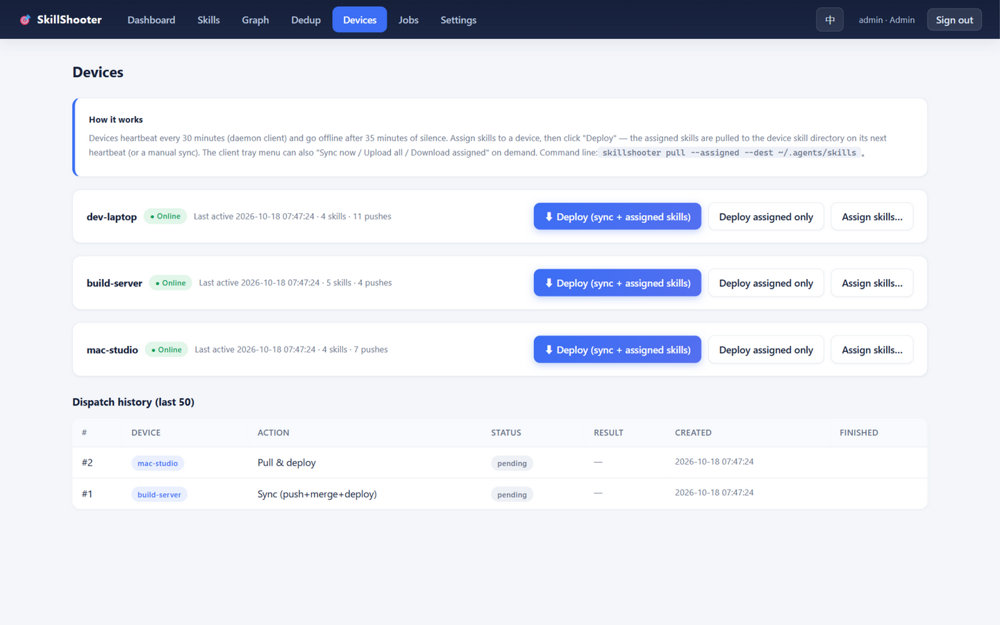
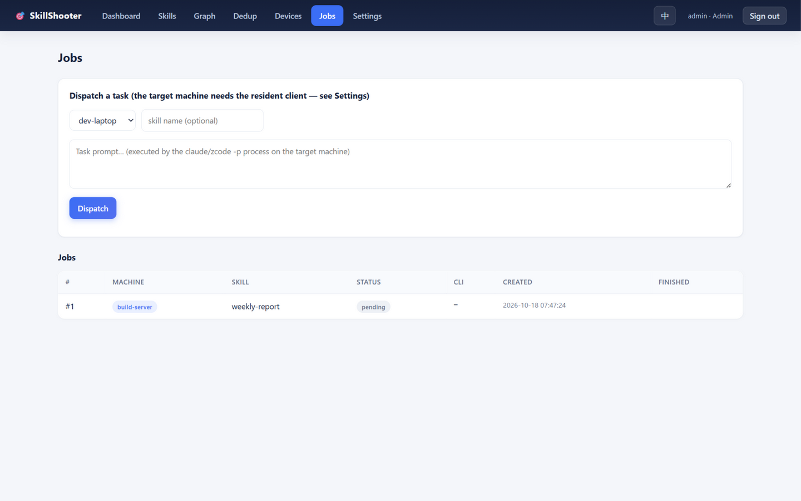

# 🎯 SkillShooter

English | [中文](README.zh-CN.md)

[](LICENSE)
[](https://go.dev)
[](#requirements)
[](#architecture)
[](#features)

**A cross-machine management platform for agent skills.** Collect the skills scattered across your machines and AI coding tools (ZCode / Claude Code / the generic `.agents` layout) into one self-hosted service: unified collection, full version history, smart dedup & merge, a relation graph, cross-machine distribution and remote execution. Server and client are two separate single-file Go binaries with zero runtime dependencies — run `skillshooter-server` once on your VPS, and `skillshooter-client` on every managed machine.



## Requirements

- Go 1.21+ to build from source (declared in `go.mod`)
- Zero runtime dependencies: SQLite is embedded through pure-Go `modernc.org/sqlite` — no database or runtime to install
- Platforms: Windows / Linux / macOS (the system tray is Windows-only; other platforms run the CLI daemon)

## Installation

**Option 1: one-click GitHub Codespaces (no server needed)**

[](https://codespaces.new/Herbicide7665/skillShooter?quickstart=1)

Click the badge and Codespaces spins up a cloud sandbox that builds the project and starts the server in the background (port 8790 is forwarded and the web console opens automatically):

- The initial admin username and password are printed once in the setup terminal (also written to `serve.log` inside the instance) — change them after the first login
- No LLM key is configured in the sandbox, so smart features (dedup judgment / merge / relation clustering) degrade gracefully; everything else is fully usable
- Data lives inside the sandbox and is destroyed when the Codespace is deleted; the free tier covers 120 core-hours per month
- While the repository is private only collaborators can launch it; once public, anyone can get a temporary instance with one click

**Option 2: download prebuilt binaries**

[Releases](https://github.com/Herbicide7665/skillShooter/releases/latest) provides two binaries per platform (windows / linux amd64+arm64 / darwin amd64+arm64):

- `skillshooter-server-*` — the hub. One instance, on your VPS/server.
- `skillshooter-client-*` — the managed-machine agent (Windows tray or CLI).

The client can also be distributed by the hub itself: put the `skillshooter-client-*` builds next to the server binary and the settings page / bootstrap scripts hand out pre-configured clients (see step 3). `chmod +x` first on Linux/macOS.

**Option 3: build from source**

```bash
go build -o skillshooter-server  ./cmd/skillshooter-server
go build -o skillshooter-client  ./cmd/skillshooter-client
```

## Quick start

Two roles, two binaries: **server** on the hub machine (all data lives next to it: `skillshooter.db` created automatically + `config.yaml`, template: [config.yaml.example](config.yaml.example)); **client** on every managed machine (common flags `--server` / `--token`, or environment variables `SKILLSHOOTER_SERVER` / `SKILLSHOOTER_TOKEN`).

**1. Start the server (hub, e.g. on a VPS)**

```bash
./skillshooter-server serve        # default 0.0.0.0:8790
# optional flags: --addr 0.0.0.0:9000 --db /data/skillshooter.db
```

The first start prints the **API token** and the **initial admin username and password** (once only). You can preset the password with `SKILLSHOOTER_ADMIN_PASSWORD`.

**2. Sign in to the web console**

Open `http://SERVER_IP:8790` → sign in as admin. The settings page lets you: create device-bound user tokens, copy onboarding commands for new machines, and configure + test the LLM connection.

**3. Onboard each machine (one command)**

```bash
# copy straight from the hub settings page (token already injected):
curl -fsSL http://SERVER:8790/agent.sh | sh -s -- --server http://SERVER:8790 --token TOKEN
# on Windows use the agent.ps1 bootstrap command from the settings page
```

The bootstrap script downloads the `skillshooter-client` binary from the server's `/dl/` endpoint for your OS/arch into `~/.skillshooter/` (drop the client builds next to the server binary first — the settings page "one-click" buttons do the same), discovers the skill directories under `~/.agents`, `~/.claude` and `~/.zcode`, and pushes them in bulk. It is idempotent; pass `--daemon` to enter resident mode straight away. You can also push a single directory manually:

```bash
skillshooter-client push --server http://SERVER:8790 --token TOKEN --path ~/.agents/skills --hostname my-laptop
```

**4. Resident client (recommended on every machine)**

```bash
skillshooter-client daemon     # full command is copyable from the settings page
```

Defaults: 30s incremental watch-and-push, 5min apply-cloud-merges, remote-job polling, 30min heartbeat — all tunable via flags. On Windows the resident client is a tray icon; the tray "Configure…" dialog edits server URL / token / device name / intervals / watch directories visually, and a first start without configuration opens the setup wizard directly.

**5. Configure the LLM (optional, enables dedup judgment / merge proposals / relation clustering)**

In `config.yaml`:

```yaml
llm_api_key: "your key"
llm_base_url: "https://api.openai.com/v1"   # any OpenAI-compatible endpoint; a base_url containing /anthropic switches to the Anthropic protocol
llm_model: "your-model"
```

Priority: environment variables (`LLM_API_KEY`, with `GLM_API_KEY` / `ZHIPUAI_API_KEY` as aliases; `SKILLSHOOTER_LLM_BASE_URL`; `SKILLSHOOTER_LLM_MODEL`) > saved in the web settings page > `config.yaml`. Without `model` the smart features degrade and everything else keeps working. The settings page has a connectivity test button.

## Features

**Unified collection** — the client recursively discovers every directory containing a `SKILL.md` (plugin caches with deep nesting included) and pushes automatically; all machines' skills land in one searchable list with machine/family filters, version counts and content hashes. Only the SKILL.md core document is collected — local scripts and data artifacts never enter the store:



**Full version history** — every push stores a new version addressed by content: a timeline per skill, unified diff between any two versions, and history versions browsable and downloadable as tar.gz:



**Smart dedup & merge** — exact hash grouping + name/description similarity pre-screening + LLM judgment per pair (confidence and reasoning shown with each group); merge proposals come with a side-by-side preview and a diff against the original, and nothing is written until a human clicks "Adopt":



**Relation graph** — reference edges parsed from SKILL.md bodies plus LLM-clustered "related / chain" relations and families; a force-directed graph colored by family, click a legend chip to focus a family, double-click a node for details:



**Cross-machine distribution & remote execution** — assign skills to a machine on the Devices page; dispatched commands land on the target with the next heartbeat (or `pull --assigned` manually). "Remote execution" hands a task to the claude/zcode CLI on the target machine and collects the report:





Smart features depend on an LLM, but it is optional: without one, dedup falls back to pre-screened groups, merge and relation clustering are unavailable, and everything else works as usual.

### Multi-machine collaboration & security

- **Dual identity**: the web console uses account login (admin has full control, user is read-only); API tokens are client credentials — the two never mix
- **One token, one device**: a user token can be created unbound and is auto-claimed (and locked) on the client's first push/heartbeat; it can only read and write "skills pushed by this machine + skills assigned to it", gets 403 otherwise, and admins can rebind
- **Transport and storage**: API requests are HMAC-SHA256 signed (±10 min window + nonce replay protection); web passwords are stored with PBKDF2-HMAC-SHA256; login locks out for 60s after 5 failures
- **No privilege escalation from clients**: the client download endpoint embeds the requester's own token — a token handed to a normal user can never escalate

### Client experience

- Windows tray resident client with a visual configuration dialog (see [Quick start](#quick-start) step 4); cross-platform CLI: `push` / `pull` / `daemon` / `config`
- One-click Chinese/English UI switch; built-in and duplicate skills can be hidden with one click

## Architecture

```
 ┌───────────────┐ push / pull / heartbeat      ┌─────────────────────────────┐
 │  machine A    │───────(HMAC-signed requests)▶│ hub: skillshooter-server    │
 │ skillshooter- │◀────(assigned skills /       │  · SQLite WAL content-      │
 │ client daemon │     merged results / jobs)───│  · addressed blob storage   │
 └───────────────┘                              │  · web console (accounts)   │
 ┌───────────────┐                              │  · /dl/ hands out pre-      │
 │  machine B …  │──────────── same as above ────────────────────────┘
 └───────────────┘                              └────────────▲───────┬────────┘
                                                    browser http://server:8790
```

The full client↔server `/api/*` protocol (three auth modes, the signature algorithm, endpoint list) is documented in [PROTOCOL.md](PROTOCOL.md).

## CLI reference

`skillshooter-server`:

| command | what it does |
|---|---|
| `serve` | start the web server (default `:8790`) |

`skillshooter-client`:

| command | what it does |
|---|---|
| `push` | scan a directory and push skills (recursive SKILL.md discovery) |
| `pull` | pull the latest versions from the hub (skips existing; same-name skills from different machines become `name@machine`) |
| `daemon` | resident client: incremental push + apply cloud merges + claim remote jobs |
| `config` | terminal configuration wizard (Enter keeps the current value) |
| `upload` | alias of `push` |
| *(no args)* | tray resident mode from saved config (Windows) |

## Data & operations

- All data lives next to the server binary: `skillshooter.db` (SQLite/WAL, content-addressed blob storage) + `config.yaml`
- **Backup = copy one db file; migration = copy db + server binary**
- Client machines keep no state beyond `~/.skillshooter/` (config.json, logs, downloaded jobs)
- No external dependencies — open the port in the firewall and go; for public deployments put nginx with TLS in front

## Releasing (maintainers)

Tag a version and push it — `git tag v2.4.0 && git push origin v2.4.0` — then attach cross-compiled binaries to the GitHub release:

```bash
for osarch in "linux amd64" "linux arm64" "darwin amd64" "darwin arm64" "windows amd64"; do
  set -- $osarch
  GOOS=$1 GOARCH=$2 go build -o skillshooter-server-$1-$2  ./cmd/skillshooter-server
  GOOS=$1 GOARCH=$2 go build -o skillshooter-client-$1-$2  ./cmd/skillshooter-client
done
# `go build -o` does not append .exe on GOOS=windows — ship the windows client as
# skillshooter-client.exe (the bootstrap downloads /dl/skillshooter-client.exe).
# Put the skillshooter-client-* builds next to the server binary on the VPS so /dl/
# and the settings page can hand out pre-configured clients
```

## Testing

```bash
go test ./...
```

## Known limitations

- Plain HTTP transport; put a TLS reverse proxy in front for public deployments
- Diff covers SKILL.md only; changes to other files show up in the version timeline (tree-hash change) without per-file diffs
- LLM judgment/merge runs pair by pair, so scan time grows with the skill count
- The tray is Windows-only; on Linux/macOS run the CLI daemon under systemd/nohup

## License

Licensed under [Apache-2.0](LICENSE).
