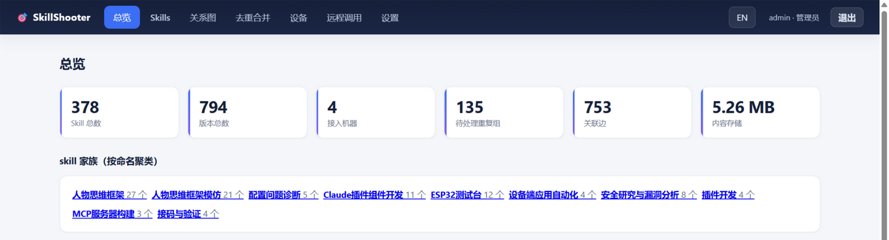
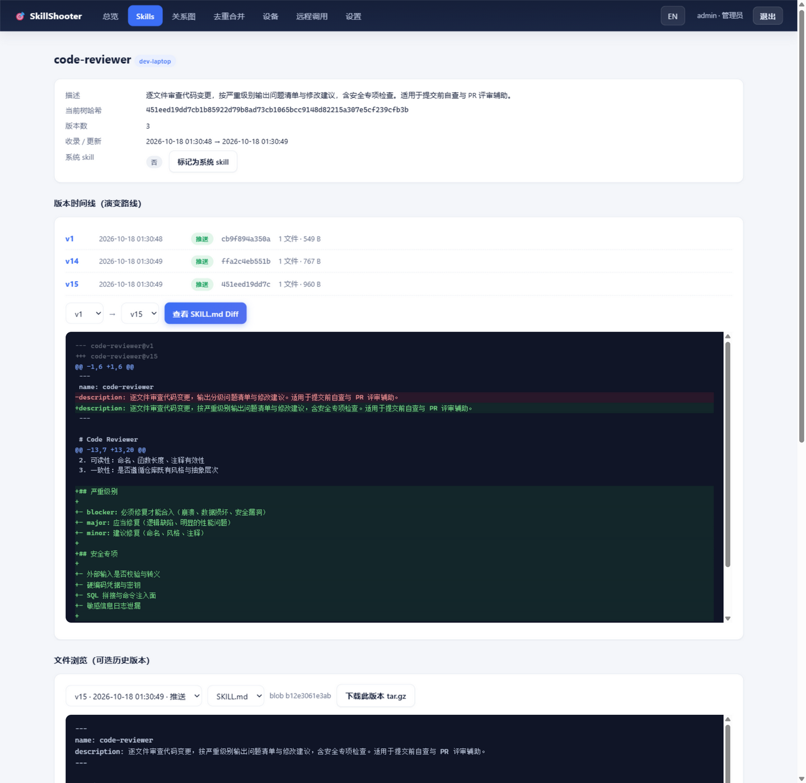

# 🎯 SkillShooter

[](https://go.dev)
[](#环境要求)
[](#架构)
[](#功能亮点)

**跨机器的 Agent Skill 管理平台。** 把散落在各台机器、各个 AI 编程工具（ZCode / Claude Code / 通用 `.agents` 体系）里的 skill 集中到一个自托管服务：统一收录、全量版本历史、智能去重合并、关系图谱、跨机分发与远程调用。服务端与客户端是同一个 Go 二进制，无任何运行时依赖。



## 环境要求

- 源码构建需要 Go 1.21+（`go.mod` 声明 go 1.21）
- 运行零外部依赖：SQLite 经 `modernc.org/sqlite` 纯 Go 内嵌，无需安装数据库或运行时
- 平台：Windows / Linux / macOS（系统托盘为 Windows 专属，其余平台用 CLI 常驻）

## 安装

**方式一：GitHub Codespaces 一键云实例（零服务器）**

[](https://codespaces.new/Herbicide7665/skillShooter?quickstart=1)

点击按钮，Codespaces 会开一个云端沙箱，自动完成构建并后台启动服务端（端口 8790 自动转发、自动打开 web 控制台）：

- 初始管理员账号密码在启动终端打印一次（也写在实例内 `serve.log`），登录后请尽快修改
- 沙箱未配置 LLM key，去重/合并/关系归纳等智能功能自动降级，其余功能完整可玩
- 数据保存在沙箱内，删除 Codespace 即销毁；免费额度每月 120 核时
- 仓库私有期间仅协作者可拉起；转为 Public 后任何人都能一键获得自己的临时实例

**方式二：源码构建**

```bash
go build -o skillshooter .
```

## 配置

全部数据与配置都在二进制同目录：`skillshooter.db`（自动创建）+ `config.yaml`（模板见 [config.yaml.example](config.yaml.example)）。

服务端：

- 监听与存储：`--addr`（默认 `0.0.0.0:8790`）、`--db`（默认二进制同目录 `skillshooter.db`）
- 初始管理员密码可用环境变量 `SKILLSHOOTER_ADMIN_PASSWORD` 预设，否则随机生成并仅打印一次

客户端公共参数：`--server` / `--token`，或环境变量 `SKILLSHOOTER_SERVER` / `SKILLSHOOTER_TOKEN`。

LLM（可选，开启去重判定/合并建议/关系归纳）——`config.yaml`：

```yaml
llm_api_key: "你的key"
llm_base_url: "https://api.openai.com/v1"   # 任意 OpenAI 兼容端点；含 /anthropic 时自动走 Anthropic 协议
llm_model: "your-model"
```

优先级：环境变量（`SKILLSHOOTER_LLM_API_KEY` / `LLM_API_KEY`，兼容 `GLM_API_KEY` / `ZHIPUAI_API_KEY`；`SKILLSHOOTER_LLM_BASE_URL`；`SKILLSHOOTER_LLM_MODEL`）> web 设置页保存 > `config.yaml`。`model` 未配置时智能功能降级不可用，其余功能不受影响。设置页有「测试连通性」按钮。

## 快速开始

**1. 启动服务端**

```bash
./skillshooter serve                # 默认 0.0.0.0:8790
# 可选参数: --addr 0.0.0.0:9000 --db /data/skillshooter.db
```

首次启动会打印 **API token** 和**初始管理员账号密码**（仅此一次）。

**2. 登录 web 后台**

打开 `http://SERVER_IP:8790` → admin 登录。设置页可：创建绑定设备的 user token、复制新机器接入命令、配置并测试 LLM 连通性。

**3. 机器接入（每台要纳管的机器，一条命令）**

```bash
# 在 hub 设置页复制即可（token 已注入）：
curl -fsSL http://SERVER:8790/agent.sh | sh -s -- --server http://SERVER:8790 --token TOKEN
# Windows 用设置页复制的 agent.ps1 引导命令
```

引导脚本自动按 OS/架构从服务端 `/dl/` 下载二进制到 `~/.skillshooter/`，发现 `~/.agents`、`~/.claude`、`~/.zcode` 下的 skill 目录并全量推送；幂等可重复执行，`--daemon` 参数可直接进入常驻模式。也可手动推送单个目录：

```bash
skillshooter push --server http://SERVER:8790 --token TOKEN --path ~/.agents/skills --hostname my-laptop
```

**4. 常驻客户端（推荐每台机器都跑）**

```bash
skillshooter daemon     # 设置页可复制完整命令
```

默认 30s 增量监控推送、5min 自动应用云端合并、轮询领取远程任务、30min 心跳探活，均可用参数调整。Windows 下常驻为托盘图标，托盘「配置…」弹窗可视化修改服务端地址 / Token / 设备名 / 各间隔 / 监控目录；首次无配置启动直接弹出配置向导。

**5. 配置 LLM（可选）**

见[配置](#配置)一节；未配置时其余功能完整可用。

## 它解决什么问题

| 没有 SkillShooter 时 | SkillShooter 的答案 |
|---|---|
| skill 散落多台机器、多个工具目录（`~/.agents`、`~/.claude`、`~/.zcode`…），查找、备份、同步全靠人肉 | 中心服务端 + 每机一个客户端，自动发现、集中收录、按需分发 |
| skill 改了无数轮，历史丢失，想回滚或对比无从下手 | 每次 push 按目录树 sha256 内容寻址，内容变化才存新版本，**全历史永久保留**，任意两版本 unified diff |
| 同名/近似 skill 在不同机器重复造轮子，没人说得清哪份最新最好 | 精确哈希分组 → 名称/描述相似度预筛 → LLM 逐对判定（附置信度与理由），生成合并建议供人工采纳 |
| skill 之间的引用、调用关系只存在作者脑子里 | 解析 SKILL.md 正文引用建边 + LLM 归纳「相关 / 调用链」边，力导向关系图可视化 |
| 换新机器要手工搬运 skill 目录 | 一条命令接入：引导脚本自动下载客户端、全盘发现、批量推送；`pull` 随时把最新版拉回本地 |
| 想在另一台机器上执行某个 skill 的活儿 | 「远程调用」页下发任务，目标机器 daemon 拉起 claude/zcode 执行并回传报告 |

## 功能亮点

**收录与版本管理**
- 全盘递归发现含 `SKILL.md` 的目录（插件缓存多层嵌套也能处理）；仅收录 SKILL.md 核心文档，本机脚本与数据产物永不入库
- 内容寻址版本化：版本时间线、任意两版本 diff、历史版本 tar.gz 打包下载

**智能功能（LLM 可选，任意 OpenAI 兼容 API）**
- **去重**：精确哈希分组 + 中文 bigram Jaccard 预筛 + LLM 逐对判定
- **合并**：LLM 生成合并版 SKILL.md，并排预览 + diff 对比，人工点「采纳」才落新版本，绝不自动覆盖
- **关系与家族**：引用建边、LLM 归纳 related/chain 边、按命名聚类家族，关系图按家族着色
- **优雅降级**：未配置 LLM 时去重退化到预筛，合并与关系归纳不可用，其余功能完整

**多机协作与安全**
- **双轨身份**：web 后台 = 账号登录（admin 全权 / user 全局只读）；API token = 客户端凭据，两者互不通用
- **一 token 一设备**：user token 创建时可留空绑定，客户端首次 push/心跳自动认领锁死；只能读写「本机推送 + 分配给本机」的 skill，越权 403，管理员可改绑
- API 请求 HMAC-SHA256 签名（±10 分钟时间窗 + nonce 防重放）；web 密码 PBKDF2-HMAC-SHA256 存储；登录失败 5 次/60 秒锁定
- 客户端下载接口内嵌请求者自己的 token——普通用户拿到的客户端永远无法提权

**客户端体验**
- Windows 托盘常驻 + 可视化配置弹窗（见[快速开始](#快速开始)第 4 步）
- 跨平台 CLI：`push` / `pull` / `daemon` / `config`
- 中英双语界面一键切换；系统自带 skill / 重复 skill 一键隐藏

## 界面

**Skill 详情**——版本时间线、任意两版本 diff：



## 架构

```
 ┌──────────────┐    push / pull / 心跳 / 任务认领      ┌──────────────────────────┐
 │  机器 A       │ ──────────(HMAC 签名请求)──────────▶ │  服务端: skillshooter serve│
 │  daemon + CLI │ ◀─────────(分配的 skill /           │  · SQLite WAL 内容寻址存储 │
 └──────────────┘           合并成果 / 远程任务)─────── │  · web 后台（账号会话登录） │
 ┌──────────────┐                                      └────────────▲─────────────┘
 │  机器 B …     │ ───────────────── 同上 ──────────────────────────┘
 └──────────────┘                                        浏览器 http://server:8790
```

客户端↔服务端的全部 `/api/*` 通讯协议（认证三模式、签名算法、端点清单）见 [PROTOCOL.md](PROTOCOL.md)。

## CLI 一览

| 子命令 | 作用 |
|---|---|
| `serve` | 启动 web 服务端（默认 `:8790`） |
| `push` | 扫描目录推送 skill（递归发现 SKILL.md） |
| `pull` | 拉取 hub 最新版本到本地（默认跳过已存在，同名多机自动 `名字@机器` 区分） |
| `daemon` | 常驻客户端：增量监控推送 + 自动应用云端合并 + 领取远程任务 |
| `config` | 终端配置向导（回车保留当前值） |
| `upload` | `push` 的别名 |

## Web 页面

| 页面 | 内容 |
|---|---|
| 总览 | skill/版本/机器/重复组/关联边计数、内容存储量、skill 家族、设备在线状态（心跳探活）、最近变更流 |
| Skills | 搜索、按机器/家族过滤、版本数与树哈希、隐藏系统/重复 skill 开关 |
| Skill 详情 | 基本信息、版本时间线、任意版本 diff、出入关联边 |
| 关系图 | 力导向图，节点按家族着色、图例聚焦；「更新关系」触发 LLM 重构并固化 |
| 去重合并 | 执行扫描、LLM 判定理由、生成合并建议、并排预览、采纳/忽略 |
| 设备 | token 管理（创建/绑定/改绑/吊销）、skill 分配、手动分发 |
| 远程调用 | 下发任务（机器/skill/提示词）、任务列表、执行报告查看（仅管理员） |
| 设置 | LLM 配置与连通测试、接入引导命令、daemon 命令 |

## 数据与运维

- 全部数据在二进制同目录：`skillshooter.db`（SQLite/WAL，内容寻址 blob 存储）+ `config.yaml`
- **备份 = 拷走一个 db 文件；迁移 = 拷走 db + exe**
- 无外部依赖，端口放行防火墙即可；公网部署建议 nginx 反代加 TLS

## 测试

```bash
go test ./...
```

## 已知限制

- 明文 HTTP 传输，公网部署请套 TLS 反向代理
- diff 仅针对 SKILL.md；其余文件变更体现在版本时间线（树哈希变化）但无逐文件 diff
- LLM 判定/合并为逐对串行调用，skill 数量大时扫描耗时随之增长
- 托盘为 Windows 专属，Linux/macOS 用 CLI + systemd/nohup 常驻

## License

暂未设置开源许可证（保留所有权利）。
